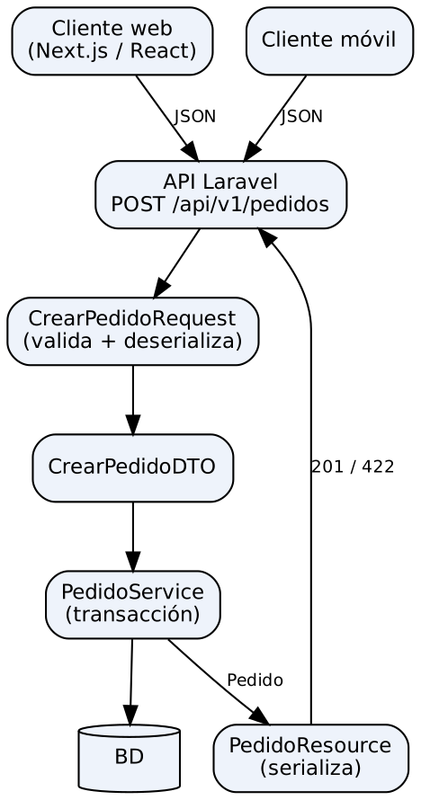

# NexoCommerce – Backend API

API REST en Laravel del proyecto de aula **NexoCommerce** (IS-803, 8.º nivel A).

Contiene tres prácticas:

- **2.2 – DTO y contratos de intercambio JSON:** registrar un pedido con `POST /api/v1/laboratorio/pedidos`, validando
  la entrada, tipándola con DTO y devolviendo un JSON con contrato fijo.
- **2.3 – Patrones de traducción y normalización:** traducir un pedido que llega en dos formatos distintos
  (formulario web y servicio externo) al contrato común del backend.
- **3.3 – Orquestación y composición de capacidades:** un endpoint orquestador que compone la respuesta de
  dos servicios independientes (usuarios y estados), con timeout, errores 502 controlados y `X-Correlation-ID`.

**Contenido**

1. [Inicio rápido](#1-inicio-rápido)
2. [Dónde está cada cosa](#2-dónde-está-cada-cosa)
3. [Endpoints](#3-endpoints)
4. [Cómo viaja una petición](#4-cómo-viaja-una-petición)
5. [Contrato JSON](#5-contrato-json)
6. [Pruebas](#6-pruebas)
7. [Práctica 2.3 – Normalización](#7-práctica-23--traducción-y-normalización)
8. [Práctica 3.3 – Orquestación](#8-práctica-33--orquestación-y-composición)
9. [Notas y límites conocidos](#9-notas-y-límites-conocidos)

---

## 1. Inicio rápido

Requisitos: PHP 8.3+, Composer y la extensión `pdo_sqlite` (la base por defecto es SQLite).

```bash
composer install
cp .env.example .env
php artisan key:generate
php artisan migrate --seed     # crea tablas, el usuario id=1 y los productos id=1 e id=4
php artisan serve              # http://127.0.0.1:8000
```

Probar el endpoint: importar la colección de Postman (ver [sección 6](#postman)) o ejecutar
`php artisan test --filter=CrearPedidoTest`.

---

## 2. Dónde está cada cosa

### Práctica 2.2 (registrar pedido)

| Qué | Dónde | Para qué |
|---|---|---|
| Ruta | `backend/routes/api.php` (grupo `laboratorio`) | `POST /api/v1/laboratorio/pedidos` |
| Controlador | `backend/app/Http/Controllers/Laboratorio/PedidoLaboratorioController.php` | `store()`: responde 201 |
| Validación + deserialización | `backend/app/Http/Requests/Laboratorio/CrearPedidoLaboratorioRequest.php` | Reglas, mensajes en español y `toDto()` |
| DTO de entrada | `backend/app/Aplicacion/Laboratorio/DTOs/CrearPedidoDTO.php` | Pedido tipado e inmutable |
| DTO de ítem | `backend/app/Aplicacion/Laboratorio/DTOs/ItemPedidoDTO.php` | Línea `producto_id` + `cantidad` |
| Lógica de negocio | `app/Services/PedidoService.php` | Precios desde BD, total en centavos, transacción |
| Serialización de salida | `app/Http/Resources/PedidoResource.php` | Modelo → JSON del contrato |
| Modelos | `app/Models/Pedido.php`, `app/Models/PedidoItem.php` | Eloquent |
| Migraciones | `database/migrations/2026_11_13_000000_create_productos_table.php`<br>`database/migrations/2026_11_13_000001_create_pedidos_tables.php` | Tablas `productos`, `pedidos`, `pedido_items` |
| Datos de prueba | `database/seeders/DatabaseSeeder.php` | Usuario 1 y productos 1 y 4 |
| Pruebas automáticas | `backend/tests/Integracion/Laboratorio/PedidoLaboratorioTest.php` | P1, P1b, P2, P3 |
| Diagrama | `docs/diagrama.png` | Flujo de intercambio |
| Colección Postman | `docs/postman/Practica_2_2_Pedidos.postman_collection.json` | P1, P2, P3 con tests |

### Práctica 2.3 (normalización)

| Qué | Dónde | Para qué |
|---|---|---|
| Traductor | `backend/app/Aplicacion/Laboratorio/NormalizadorDatos.php` | `desdeFormulario()` y `desdeExterno()` → contrato común |
| Ruta | `routes/api.php` | `POST /api/v1/laboratorio/normalizar/pedido/{origen}` |
| Pruebas | `backend/tests/Unitarias/Laboratorio/NormalizadorDatosTest.php` | P1, P2, P3 |
| Documento | `docs/docx/Practica_2_3_Normalizacion_Anthony_Mejia.docx` (PDF: `docs/pdf/Practica_2_3_Normalizacion_Anthony_Mejia.pdf`) | Mapeo, diagrama y evidencias |
| Guía de la práctica | `docs/Guia/Guia_Individual_Tema_2_3_IS803 (1).docx` | Enunciado original (sin completar) |

### Práctica 3.3 (orquestación)

| Qué | Dónde | Para qué |
|---|---|---|
| Servicio de usuarios | `backend/laboratorio/servicios/usuarios.php` | Puerto 8001, `/usuarios/{id}` |
| Servicio de estados | `backend/laboratorio/servicios/estados.php` | Puerto 8002, `/estados/{id}` |
| Configuración | `backend/config/orquestador.php` + `.env` | URLs de los servicios y timeout (3 s) |
| Orquestador | `backend/app/Http/Controllers/Laboratorio/OrquestadorController.php` | `GET /api/resumen-solicitud/{id}` |
| Documento | `docs/docx/Practica_3_3_Orquestacion_Anthony_Mejia.docx` (PDF: `docs/pdf/Practica_3_3_Orquestacion_Anthony_Mejia.pdf`) | Capturas de Postman y diagrama |

### Resto del proyecto (de prácticas anteriores)

| Qué | Dónde |
|---|---|
| Controladores de ejemplo (datos fijos, sin BD) | `app/Http/Controllers/Api/` → `CategoriaController`, `ClienteController`, `EstadoController`, `PedidoController`, `ProductoController` |
| Usuario | `app/Models/User.php` (aún sin `HasApiTokens`: Sanctum está instalado y la tabla de tokens existe, pero no se emiten tokens) |
| Configuración de la app y manejo de errores JSON | `bootstrap/app.php` (todo `api/*` responde JSON) |

### Árbol resumido

```text
practica/
├── app/
│   ├── DTO/Pedidos/                 CrearPedidoDTO, ItemPedidoDTO
│   ├── Http/
│   │   ├── Controllers/Api/         controladores de ejemplo (GET)
│   │   ├── Controllers/Api/V1/      PedidoController  ← store()
│   │   ├── Requests/Pedidos/        CrearPedidoRequest
│   │   └── Resources/               PedidoResource
│   ├── Models/                      User, Pedido, PedidoItem
│   └── Services/                    PedidoService, NormalizadorDatos
├── database/
│   ├── migrations/                  productos, pedidos, pedido_items (2026_11_13_*)
│   └── seeders/                     DatabaseSeeder
├── config/orquestador.php           timeout y URLs de los servicios (3.3)
├── docs/                            diagrama, colección Postman y documentos de práctica
├── servicios/                       usuarios.php, estados.php (3.3)
├── routes/api.php                   todas las rutas de la API
├── tests/Feature/Pedidos/           CrearPedidoTest
└── tests/Unit/                      NormalizadorDatosTest
```

---

## 3. Endpoints

| Método | Ruta | Estado | Descripción |
|---|---|---|---|
| `POST` | `/api/v1/laboratorio/pedidos` | **Real** (Práctica 2.2) | Registra un pedido en la BD |
| `POST` | `/api/v1/laboratorio/normalizar/pedido/{formulario\|externo}` | **Real** (Práctica 2.3) | Devuelve el pedido en el contrato común (200) o error (422); no usa BD |
| `GET` | `/api/resumen-solicitud/{id}` | **Real** (Práctica 3.3) | Orquestador: usuario + estado + `correlation_id` (200) o 502 |
| `GET` | `/api/estado` | Ejemplo | Estado de la API |
| `GET` | `/api/productos`, `/api/productos/{id}` | Ejemplo | Datos fijos, sin BD |
| `GET` | `/api/categorias`, `/api/categorias/{id}` | Ejemplo | Datos fijos, sin BD |
| `GET` | `/api/clientes`, `/api/clientes/{id}` | Ejemplo | Datos fijos, sin BD |
| `GET` | `/api/pedidos`, `/api/pedidos/{id}` | Ejemplo | Datos fijos, sin BD |
| `GET` | `/api/user` | Plantilla de Laravel | Protegida con `auth:sanctum`; sin login todavía no devuelve datos |

---

## 4. Cómo viaja una petición



```text
JSON ─► CrearPedidoRequest ─► CrearPedidoDTO ─► PedidoService ─► BD
        (valida)               (tipa)            (precios, total,    │
                                                  transacción)       │
JSON ◄─ PedidoResource ◄───────────────── Pedido (Eloquent) ◄────────┘
        (serializa)
```

- **Deserialización:** Laravel convierte el cuerpo JSON en array; `CrearPedidoRequest` lo valida y
  `CrearPedidoDTO::fromValidated()` lo transforma en objetos tipados (`"25"` → `int 25`).
- **Serialización:** `PedidoResource` convierte el modelo en un array con nombres y tipos fijos,
  independiente de la estructura de la base de datos.
- **Decisión de diseño:** el cliente **no envía precios ni totales**. El servidor los calcula desde
  `productos` en centavos (enteros) y los devuelve como `string` decimal, para que web y móvil no puedan
  manipularlos y para evitar errores de redondeo de punto flotante.

---

## 5. Contrato JSON

### Solicitud — `POST /api/v1/laboratorio/pedidos`

Cabeceras: `Accept: application/json` y `Content-Type: application/json`.

| Campo | Tipo | Obligatorio | Regla |
|---|---|---|---|
| `cliente_id` | integer | Sí | Debe existir en `users` |
| `metodo_pago` | string | Sí | `efectivo` \| `tarjeta` \| `transferencia` |
| `fecha_entrega` | string `YYYY-MM-DD` | Sí | Hoy o posterior |
| `observacion` | string \| null | No | Máx. 255 caracteres |
| `items` | array | Sí | Al menos 1 |
| `items[].producto_id` | integer | Sí | Debe existir en `productos` |
| `items[].cantidad` | integer | Sí | 1 a 100 |

```json
{
  "cliente_id": 1,
  "metodo_pago": "tarjeta",
  "fecha_entrega": "2026-11-20",
  "observacion": "Entregar en la tarde",
  "items": [
    { "producto_id": 1, "cantidad": 2 },
    { "producto_id": 4, "cantidad": 1 }
  ]
}
```

### Respuesta `201 Created`

| Campo | Tipo | Nota |
|---|---|---|
| `data.pedido_id` | integer | Generado por el servidor |
| `data.estado` | string | Inicia en `pendiente` |
| `data.cliente_id`, `data.metodo_pago`, `data.fecha_entrega` | — | Lo registrado |
| `data.observacion` | string \| null | Siempre presente (`null` si no se envió) |
| `data.items[]` | array | `producto_id`, `cantidad`, `precio_unitario`, `subtotal` |
| `data.items[].precio_unitario` / `subtotal` | string decimal | 2 decimales, p. ej. `"12.50"` |
| `data.total` | string decimal | Suma de subtotales |
| `data.creado_en` | string ISO 8601 | Con zona horaria |
| `mensaje` | string | Texto informativo |

```json
{
  "data": {
    "pedido_id": 1,
    "estado": "pendiente",
    "cliente_id": 1,
    "metodo_pago": "tarjeta",
    "fecha_entrega": "2026-11-20",
    "observacion": "Entregar en la tarde",
    "items": [
      { "producto_id": 1, "cantidad": 2, "precio_unitario": "12.50", "subtotal": "25.00" },
      { "producto_id": 4, "cantidad": 1, "precio_unitario": "15.00", "subtotal": "15.00" }
    ],
    "total": "40.00",
    "creado_en": "2026-11-13T15:19:39+00:00"
  },
  "mensaje": "Pedido registrado correctamente"
}
```

### Respuesta `422 Unprocessable Entity`

Falta un campo, tipo incorrecto o regla incumplida. No se guarda nada.

```json
{
  "message": "El campo metodo_pago es obligatorio.",
  "errors": { "metodo_pago": ["El campo metodo_pago es obligatorio."] }
}
```

Si hay varios errores, `message` muestra el primero y añade `(and N more errors)` (texto de Laravel);
el detalle completo está en `errors`.

---

## 6. Pruebas

### Automáticas

```bash
php artisan test --filter=CrearPedidoTest    # solo la práctica
php artisan test                             # toda la suite
```

Usan SQLite en memoria (`phpunit.xml`), no tocan tu base de desarrollo.

| Caso | Entrada | Resultado esperado |
|---|---|---|
| P1 | JSON válido | 201 + contrato de respuesta; 1 pedido y sus ítems en BD |
| P1b | `observacion` omitida; 3 × 0.10 | `observacion: null`; total exacto `"0.30"` |
| P2 | Falta `metodo_pago` | 422 con `errors.metodo_pago`; 0 pedidos en BD |
| P3 | `cliente_id = "abc"`, `cantidad = "dos"` | 422 con `errors.cliente_id` y `errors.items.0.cantidad`; nada persistido |

### Postman

1. Tener el servidor corriendo (`php artisan serve`) y la BD sembrada (`php artisan migrate --seed`).
2. En Postman: **Import** → `docs/postman/Practica_2_2_Pedidos.postman_collection.json`.
3. Variables de la colección: `base_url` = `http://127.0.0.1:8000`, `cliente_id` = `1`.
4. Ejecutar cada petición o la colección completa con **Run**.

`fecha_entrega` se calcula sola (mañana), así que la regla «hoy o posterior» no falla según el día.
Cada petición incluye sus tests (código HTTP y estructura del contrato).

---

## 7. Práctica 2.3 – Traducción y normalización

Dos orígenes representan el mismo pedido de forma distinta; `NormalizadorDatos` los traduce al contrato común
de la [sección 5](#5-contrato-json) sin modificar los componentes de origen.

| Origen A (formulario) | Origen B (servicio externo) | Contrato común | Regla |
|---|---|---|---|
| `clienteId` (texto) | `customer.id` (número) | `cliente_id` (entero) | Desanidar/renombrar; entero positivo |
| `metodoPago` (`"Tarjeta"`) | `payment` (`"CARD"`) | `metodo_pago` (`"tarjeta"`) | Minúsculas / `CASH`, `CARD`, `TRANSFER` → `efectivo`, `tarjeta`, `transferencia` |
| `fechaEntrega` (`20/11/2026`) | `delivery_date` (`2026-11-20`) | `fecha_entrega` (`2026-11-20`) | `dd/mm/YYYY` → `YYYY-MM-DD`, valida fecha real |
| `detalle[].productoId` | `lines[].product_id` | `items[].producto_id` | Renombrar; entero positivo |
| `detalle[].cantidad` (texto) | `lines[].qty` (número) | `items[].cantidad` (entero) | Entero ≥ 1; rechaza `"2.5"`, `"abc"`, 0 |

```bash
curl -X POST localhost:8000/api/v1/laboratorio/normalizar/pedido/formulario -H 'Content-Type: application/json' \
  -d '{"clienteId":"1","metodoPago":"Tarjeta","fechaEntrega":"20/11/2026","detalle":[{"productoId":"3","cantidad":"2"}]}'
# 200 {"cliente_id":1,"metodo_pago":"tarjeta","fecha_entrega":"2026-11-20","items":[{"producto_id":3,"cantidad":2}]}
```

Un dato inválido o faltante responde `422 {"mensaje": "..."}`. Pruebas: `php artisan test --filter=NormalizadorDatosTest`.

---

## 8. Práctica 3.3 – Orquestación y composición

```text
Cliente ─► Orquestador :8000 ─► Servicio usuarios :8001  (/usuarios/7)
                          └───► Servicio estados  :8002  (/estados/101)
Cliente ◄─ {success, data:{solicitud_id, usuario, estado, correlation_id}}
```

Los servicios son scripts PHP independientes; sus URLs están en `.env` (`USUARIOS_URL`, `ESTADOS_URL`) y se
leen desde `backend/config/orquestador.php`. Levantar tres terminales:

```bash
cd backend
php -S 127.0.0.1:8001 laboratorio/servicios/usuarios.php     # servicio de usuarios
php -S 127.0.0.1:8002 laboratorio/servicios/estados.php      # servicio de estados
php artisan serve --port=8000                    # orquestador
```

```bash
curl -H 'X-Correlation-ID: abc-123' localhost:8000/api/resumen-solicitud/101
# 200 {"success":true,"data":{"solicitud_id":101,"usuario":{"id":7,"nombre":"Ana"},"estado":"pendiente","correlation_id":"abc-123"}}
```

- **Timeout:** cada llamada usa `Http::timeout(3)`.
- **Falla:** si un servicio no responde o devuelve error, se responde `502` con `{success:false, message, correlation_id}` (sin
  trazas) y el detalle queda en `storage/logs/laravel.log` junto con el `correlation_id`. Se prueba deteniendo
  uno de los servicios con `Ctrl+C`.
- **Correlation ID:** se toma del header `X-Correlation-ID` o se genera un UUID; se reenvía a los servicios y
  se devuelve en el JSON y en el header de respuesta.

---

## 9. Notas y límites conocidos

- **Sin autenticación en el endpoint:** `CrearPedidoRequest::authorize()` devuelve `true` y `cliente_id`
  viene en el cuerpo. Para producción, proteger la ruta con `auth:sanctum` y tomar el cliente del usuario
  autenticado.
- **Zona horaria:** `creado_en` sale en UTC (`+00:00`) porque `config/app.php` usa `UTC`.
- **Los controladores de ejemplo** (`/api/productos`, `/api/pedidos`…) devuelven datos fijos y **no leen** la
  tabla `productos` ni `pedidos`; el registro real de pedidos solo existe en `POST /api/v1/laboratorio/pedidos`.
- **Orquestador (3.3):** el usuario consultado está fijo en `7` (el enunciado no define cómo obtenerlo de la
  solicitud) y las dos llamadas son secuenciales. La lógica vive en un closure de `routes/api.php`.
- **Normalizador (2.3):** el endpoint solo traduce y valida; no registra el pedido ni comprueba que el cliente
  o los productos existan.
- **Catálogo mínimo:** la tabla `productos` solo tiene `nombre` y `precio`; `DatabaseSeeder` inserta 2
  productos de prueba (ids 1 y 4). Ejecutarlo dos veces falla por ids duplicados: usar `php artisan migrate:fresh --seed`.
